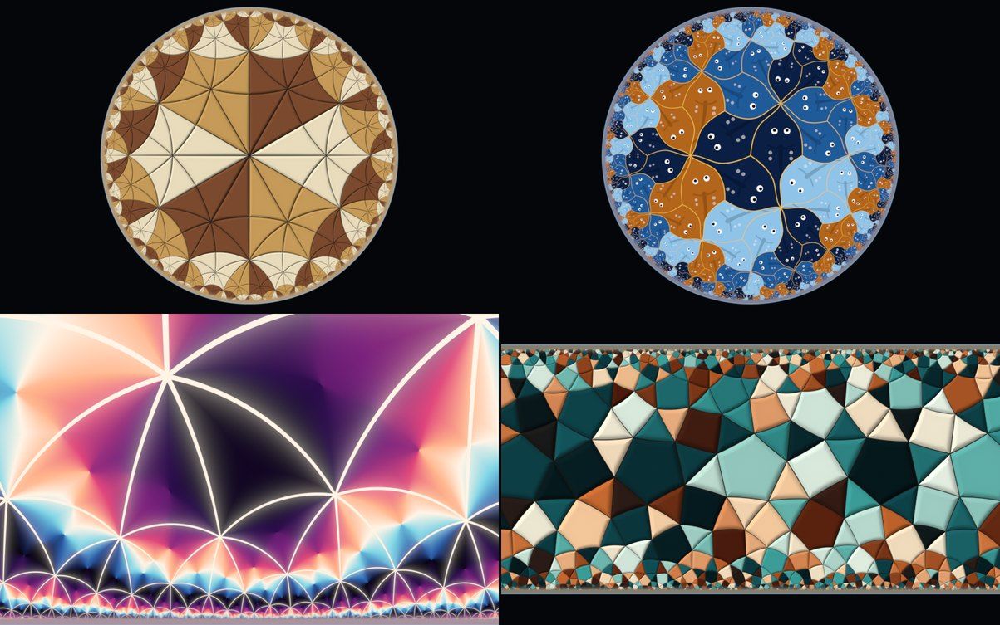
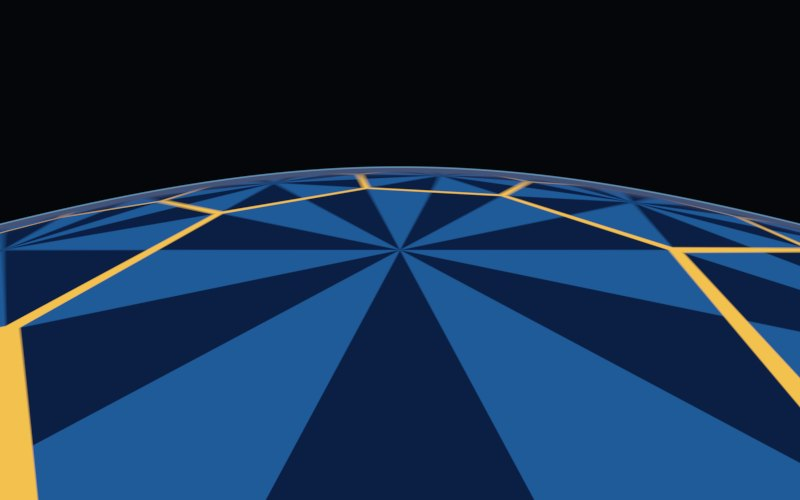

# Hyperscope

A GPU explorer of the hyperbolic plane. Every pixel is mapped onto the hyperboloid, moved by the
camera and folded by reflections into one triangle of a tiling, so the picture is exact at any zoom
and runs smoothly in a browser.



**Try it:** open <https://bartsikorski.github.io/hyperscope/>, or download `hyperscope.html` from the
[latest build](https://github.com/bartsikorski/hyperscope/actions/workflows/pages.yml) and open it
from disk. It is one self-contained file that works offline. You need a browser with WebGL2 (any
recent Chrome, Edge, Firefox or Safari).

## What it shows

- **Seven views of the plane:** the Poincaré disk, the Klein disk, the upper half-plane, a local
  view that looks Euclidean near the centre, the band along one geodesic, the plane seen from an eye
  standing above it inside H³, and the hyperboloid itself as a surface in space.
- **Tilings:** every hyperbolic triangle group (p, q, r) with orders up to 20, with colourings of up to eight colours
  (chiral ones too), Mosaic (each tile its own colour, named exactly by integers) and the Wythoff
  constructions: truncated, rectified, cantellated, omnitruncated, the snub and a free point you drag.
- **Motifs:** tiles whose edges are bent into interlocking shapes, Escher's method, drawn sharp at
  any zoom. Four motifs of our own are built in (Shoal, Moths, Rosette, Birds) and more can be
  loaded from a JSON file.
- **Your own picture** can fill the tile, mirrored like a kaleidoscope or turned without mirroring
  (chiral), with a template to draw on so its edges match.
- **Looks:** 24 palettes, five colour sources (the colouring, distance from the centre, depth from a
  start tile, position inside the tile, Mosaic), lines with glow and relief, and 15 ready-made looks.
- **A unit grid** (Cartesian, polar or horocyclic) with R set to the Earth's radius, 1 km or 1 m.
  Its position is kept to 256 binary places, so labels stay exact down to 10⁻¹¹ R a pixel.
- **Deep zoom** and long trips, with a still picture refined to 16 samples per pixel.
- **Links, presets and screenshots:** the address bar always holds a link to the view, your presets
  stay in the browser and can be exported, and a screenshot (up to 7680 × 4320) carries its view
  inside the PNG, so dropping it on the window takes you back there.



## Controls

Press **?** or **F1** in the app for the full list. The essentials:

| Input | Action |
| --- | --- |
| drag | move the plane (an exact hyperbolic translation); it glides when released |
| wheel | zoom at the cursor (Ctrl: fine, Shift: rotate) |
| right drag | rotate about the screen centre |
| double-click / middle click | zoom 4× into that point / bring it to the centre |
| two fingers | pinch to zoom, twist to rotate, move |
| + / − (PgUp / PgDn), Z / X | zoom at the centre, at the cursor |
| W A S D or arrows, Q / E | move, rotate |
| [ / ] | rotate by one symmetry step of the tiling |
| 1 – 7 | Poincaré disk, Klein disk, half-plane, local view, inside H³, hyperboloid, band (the place you look at stays put) |
| inside H³ (5) | W A S D or drag walk, Q / E or right drag turn and look up and down, wheel or + / − lower and raise the eye from 0.01 to 6 R |
| hyperboloid (6) | drag or W A S D move the plane over the surface, right drag orbits, wheel or + / − orbit nearer or farther |
| C, L, P, K (Shift: back) | next preset tiling, look, palette, colouring |
| O, M (Shift: back) | next construction (Lines, the Wythoff tilings, the snub), next motif |
| G, T, U | unit grid on / off, its type, the size of R |
| H | home |
| Backspace / Shift+Backspace | back / forward through the views you visited |
| Ctrl+C / Ctrl+V | copy a link to this view / open a pasted link or saved state |
| Ctrl+S, F12 | save a screenshot (its view is inside the PNG) |
| Tab, F | hide the interface, full screen |
| Esc | leave a field, close the help, the settings card or the gallery |

The icon row at the top right has home, back and forward, the seven views, the presets gallery, the
grid, a screenshot, the settings card (Tiling, Look and View tabs, where every setting can be
changed, including an exact position typed to any number of digits) and the help. It fades when you
rest and comes back when you move the mouse.

A game controller works too (Xbox, PlayStation, Switch Pro and others the browser maps to its
standard layout): the left stick moves, the right stick rotates and zooms, RT and LT zoom, LB and RB
rotate by a symmetry step, A switches the view, B closes or goes back, X and Y switch the grid and
its type, the D-pad steps through presets and looks, L3 and R3 the palette and colouring, Start goes
home and View hides the interface. Press any button once so the browser shows the pad to the page.

Files dropped on the window: a Hyperscope screenshot returns to its view, a saved state opens, a
presets file adds its presets to yours, a motif file is drawn with its group, and any other picture
(PNG, JPEG, WebP) becomes the tile picture; a pasted picture does too. The picture is kept in the
browser (IndexedDB) and inside screenshots and exported presets. A link names it by its SHA-256, so
a link opened elsewhere keeps its settings and asks for the picture.

## Building and developing

Install [Node.js](https://nodejs.org) 22 LTS, then:

```sh
npm install
npm run dev      # development server at http://localhost:5173, reloads when files change
npm run build    # dist/hyperscope.html, one self-contained file
```

On Windows you can also double-click `run.bat`, which installs the dependencies on the first run
and starts the development server.

| Command | What it does |
| --- | --- |
| `npm run typecheck` | TypeScript, no output |
| `npm test` | unit tests: float64 math against 100-digit values, groups, colourings, views, camera, controls, game controllers, palettes, shading, motifs, tile pictures, grid, labels, saved state, history, presets, screenshots |
| `npm run test:gpu` | browser tests in headless Chromium (run `npx playwright install chromium` once): the shader against the CPU reference pixel by pixel, golden images, refinement, scripted input and controller, the interface, links and screenshots |
| `npm run reference` | reference pictures from the CPU renderer into `out/` |
| `npm run golden` | rewrite the golden images in `tests/golden/` (only after checking a change is intended) |
| `npm run bench` | time one sample pass per scene at 1080p and 4K (`-- --headed` uses your graphics card, `-- --channel msedge` or `chrome` a browser you have installed, `-- --tag name` names the result) |
| `npm run ab` | A/B runs of equivalent formulas: each checked to draw the same picture, then timed against the current code (same options; `-- --only name,name` runs only those) |

The formulas were checked numerically before they were coded: the scripts in
[`design-checks/`](design-checks/) need Python 3 with `mpmath`, `numpy` and `scipy`
(`python design-checks/check_math.py`, and so on; each prints what it checked).

## Layout

| Folder | What is in it |
| --- | --- |
| `src/math` | float64 geometry (hyperboloid, triangle groups, colourings, tile identity, Wythoff tilings, motifs, view maps) and colour arithmetic |
| `src/render` | the WebGL2 renderer and the float64 CPU reference renderer |
| `src/shaders` | GLSL chunks: one per view, one per content, the grid |
| `src/input` | camera moves, mouse, keyboard, touch and game controllers |
| `src/content` | tilings, presets, palettes, looks, motifs and tile pictures |
| `src/state` | the store, saved state, links, history, presets and the PNG text chunk |
| `src/ui` | the HUD, icon row, settings card, gallery, help and the grid's labels |
| `tests` | unit and browser tests, and the golden images |
| `bench` | the benchmark and A/B pages, the experiments and the saved results |
| `tools` | the reference, golden and benchmark scripts and the test-vector generators (mpmath for geometry, mandelscope's own code for palettes) |
| `design-checks` | the numerical checks of the design's formulas |
| `docs` | [design notes](docs/design-notes.md): every decision with its reasons and measurements, including the benchmarks on a software renderer and an RTX 5060 Ti |

## Credits and licence

Hyperscope builds on many people's work: HyperRogue, Matt Zucker's and Roice Nelson's GPU
tilings, Coxeter, Wythoff, Doug Dunham's methods for Escher-like patterns and others, all listed
with what was taken from each in [CREDITS.md](CREDITS.md). No artwork by M. C. Escher is
reproduced: the built-in motifs are our own designs. The palettes, the zoom spring and the HUD
style come from [mandelscope](https://github.com/bartsikorski/mandelscope). The bundled fonts and
icons are listed in [THIRD_PARTY_NOTICES.md](THIRD_PARTY_NOTICES.md).

MIT licence, see [LICENSE](LICENSE). Developed with Claude (Anthropic) as an AI programming
assistant.
